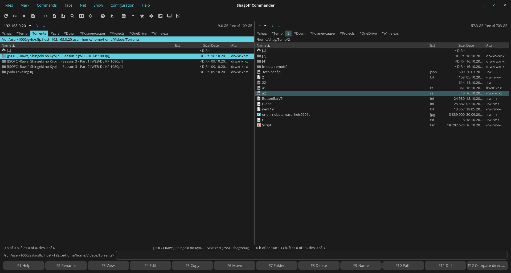
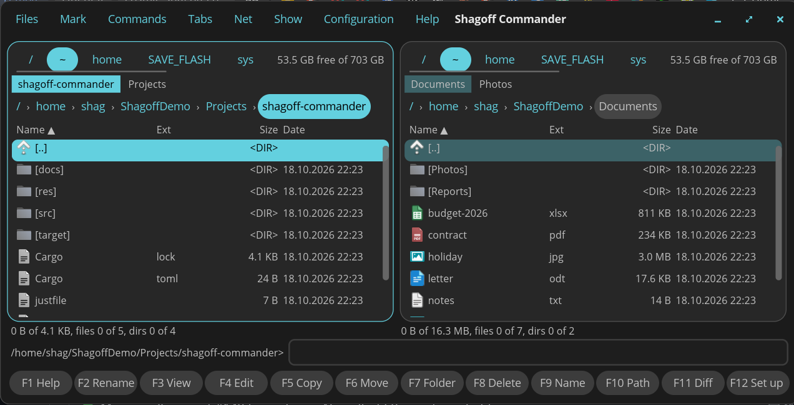
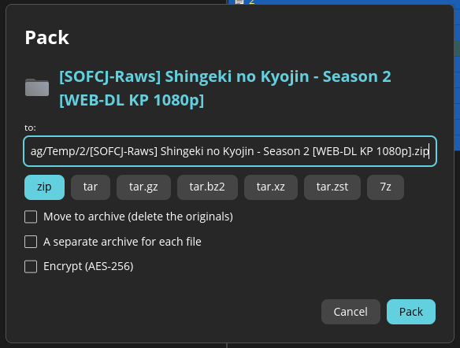
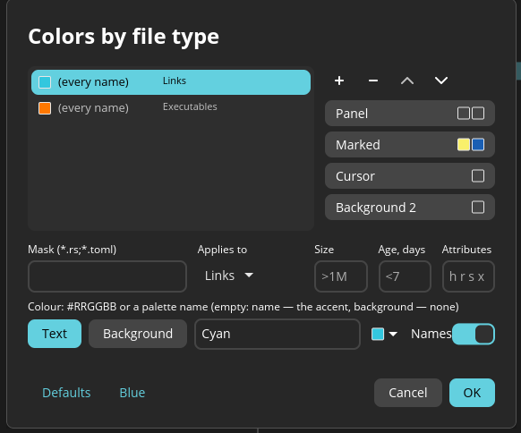
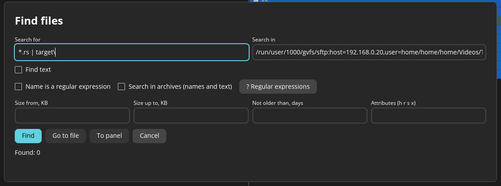
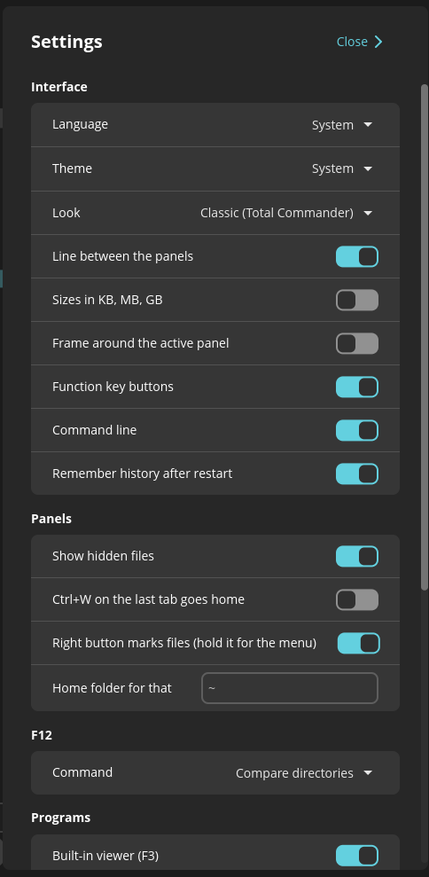
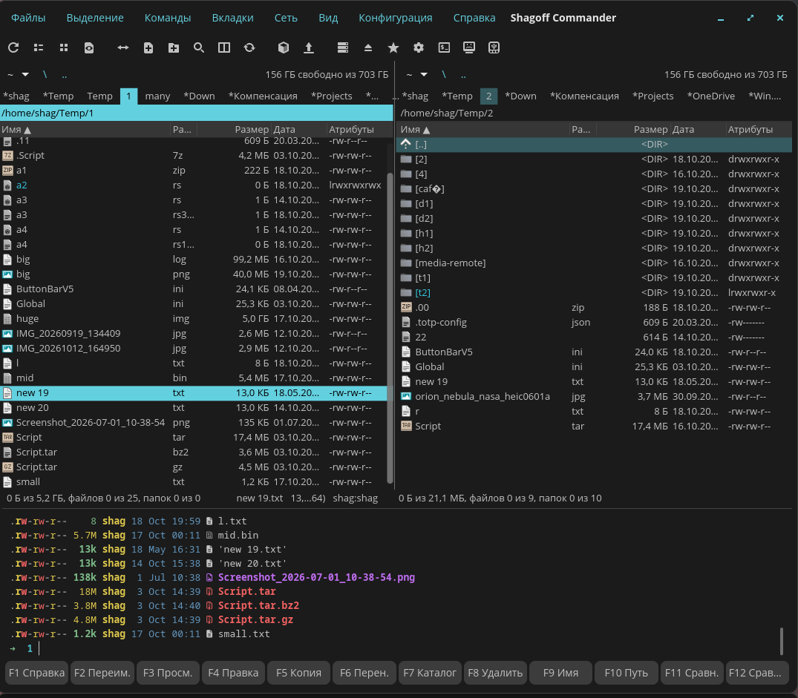

# Shagoff Commander

English | [Русский](README_ru.md)

A dual-pane file manager in the spirit of Total Commander, built with libcosmic for the COSMIC desktop (Pop!_OS 24.04).



**Status:** active development, used daily. See [.claude/docs/ROADMAP.md](.claude/docs/ROADMAP.md).

## Two looks

*Configuration → Settings… → Look* (Ctrl+,) switches them live.

| Classic (Total Commander) | Modern (COSMIC) |
|---|---|
|  |  |
| Toolbar, drive drop-down, tab strip and path line, compact rows | Drive buttons, breadcrumbs, panels as cards, larger rows |

## Features

- Two panels with tabs (lock, rename, move between panels), Total Commander keys: F3–F8, Shift+F5/F6, Insert / Space / Num+ / Num− marking, Alt+letter quick search, history and hotlist
- Copy / move / delete with conflict answers (replace, skip, replace older, rename, keep both), trash or permanent delete, clipboard compatible with COSMIC Files
- Archives as folders: zip, tar.gz / bz2 / xz / zst, 7z — browse, copy in and out, pack / unpack
- Built-in viewer (F3): text with wrap and code pages (guessed: Cyrillic 1251 / KOI8-R / 866, Western, Central European, Greek, Japanese, Chinese…), hex, images; quick view in the other panel (Ctrl+Q), also inside archives
- Find files (masks or regex, text inside, size / date, inside archives), compare and synchronize folders, compare files side by side
- Properties with permission bits, multi-rename, command line `path>`, network mounts through gvfs
- Terminal of your choice (Commands → Terminal…: the system default or any installed one) opens in the panel's folder and runs Shift+Enter
- Built-in terminal under the panels in place of the command line (Ctrl+` or View → Built-in terminal, off by default): follows the active panel's folder, Ctrl+O over the whole window, shell from Commands → Shell…
- View → «Window parts»: hide the button bar, drive buttons, tabs, path line, column headers, status bar, command line, F-key buttons; «Panel at 100 %» — one panel across the whole width, «Panels one above the other»
- Right button marks files as in Total Commander (drag it across rows to mark them), held it opens the menu (or the menu at once — a setting), full / brief view, file type icons, two looks: Classic (Total Commander) and Modern (COSMIC)

## Keys

Total Commander's layout, so the hands already know it:

| | |
|---|---|
| F3 / F4 | View / edit |
| F5 / F6 | Copy / move; F2 in the dialog puts it in the queue |
| Shift+F5 / Shift+F6 | Copy here under a new name / rename |
| F7 / F8 | New folder / delete (Shift+F8: permanently) |
| Insert, Space, Num+ / Num− | Mark one / by mask |
| Alt+F7 | Find files |
| Alt+F5 / Alt+F9 | Pack / unpack |
| Alt+Shift+F5 | Move to archive (pack, then delete the sources) |
| Ctrl+B | Branch view: every file below, in one list |
| Ctrl+D | Hotlist |
| Ctrl+F | Connect to a server (sftp, smb, ftp, dav) |
| Ctrl+T / Ctrl+W | New / close tab |
| Ctrl+Shift+D | Compare files by content |
| Alt+Enter | Properties |

## A closer look

| | |
|---|---|
|  |  |
| Pack: zip, tar.*, 7z, encrypted | Colors by file type: mask, size, age, attributes |
|  |  |
| Find files: masks, regex, text, inside archives | Settings, applied as you change them |



Built-in terminal under the panels (Ctrl+`): its shell follows the active panel's folder, Ctrl+O over the whole window

## Toolbar buttons

Right click on the toolbar (Classic look) or *Configuration → Toolbar…* opens the button editor: add, remove, move, pick an icon. A button runs an internal command (`cm_*`, picked from the list) or a program with parameters:

| | |
|---|---|
| `%P` / `%T` | the active / other panel's folder |
| `%N` | the name under the cursor; `%O` without its extension, `%E` the extension |
| `%S` | the selected names |

Each value is quoted as one shell word. The command runs through `sh -c` in the panel's folder, without a terminal. Example, a terminal that lists the file under the cursor and waits for Enter:

- Command: `cosmic-term -e`
- Parameters: `sh -c "ls -l %N; read x"`

Use double quotes around the script (the inserted names carry their own single quotes), and `read x`, not a bare `read`: `sh` is dash, where `read` without a variable fails at once and the terminal closes. A failing command shows its error in the status line.

## Install

A `.deb` for Pop!_OS 24.04 / Ubuntu 22.04 and newer (Mint 21+, Debian 12+; built against glibc 2.35) is attached to each [release](https://github.com/shagovAlexei/cosmic-shagoff-commander/releases):

```sh
sudo apt install ./shagoff-commander_*_amd64.deb
```

Fedora / openSUSE: the `.rpm` from the same release (`sudo dnf install ./shagoff-commander-*.x86_64.rpm`).
`man shagoff-commander` — the command line, files and main keys.

Each release lists the SHA-256 sums of its files in its notes and also carries `SHA256SUMS` and a signed build attestation.

Download the latest `.deb` and `SHA256SUMS` with `curl`, check the hash, install only if it matches (`--ignore-missing` skips the `.rpm` listed there):

```sh
v=$(curl -sLI -o /dev/null -w '%{url_effective}' https://github.com/shagovAlexei/cosmic-shagoff-commander/releases/latest | sed 's|.*/v||')
cd ~/Downloads && B=https://github.com/shagovAlexei/cosmic-shagoff-commander/releases/download/v$v
curl -LO "$B/shagoff-commander_${v}_amd64.deb" -LO "$B/SHA256SUMS"
sha256sum -c --ignore-missing SHA256SUMS && sudo apt install ./shagoff-commander_${v}_amd64.deb
```

The build attestation can be checked too, with `gh` 2.49 or newer: `gh attestation verify FILE.deb --repo shagovAlexei/cosmic-shagoff-commander`.
The only official place to download is the [releases page](https://github.com/shagovAlexei/cosmic-shagoff-commander/releases).

The program checks for a newer release at every start and offers it in a window (Update / Later / Skip this version); Settings → «Check for updates at start» turns it off. The update downloads the release's `.deb` and `SHA256SUMS` (from this repository only) into `~/.cache/shagoff-commander` and runs `sha256sum -c --strict`. If the hash does not match, the package is deleted, nothing is installed and the window says what did not match. If it matches, `pkexec apt-get install` runs (the system asks for the password through polkit), and then a message asks to restart the program. The package name from `SHA256SUMS` and the release tag are checked for a plain shape, so no path can be slipped into the download address.

## Update

Which version you have: **Help → About**, or `dpkg -s shagoff-commander | grep Version`.
**Check for updates** there asks GitHub for the latest release (only when pressed).
The newest one is on the [releases page](https://github.com/shagovAlexei/cosmic-shagoff-commander/releases/latest).

Install the new `.deb` over the old one — settings, tabs and history stay (they live in
`~/.config/cosmic/` and `~/.local/state/cosmic/`):

```sh
# download the latest release, check its hash, install only on a match
v=$(curl -sLI -o /dev/null -w '%{url_effective}' https://github.com/shagovAlexei/cosmic-shagoff-commander/releases/latest | sed 's|.*/v||')
cd ~/Downloads && B=https://github.com/shagovAlexei/cosmic-shagoff-commander/releases/download/v$v
curl -LO "$B/shagoff-commander_${v}_amd64.deb" -LO "$B/SHA256SUMS"
sha256sum -c --ignore-missing SHA256SUMS && sudo apt install ./shagoff-commander_${v}_amd64.deb

# or from a clone of the sources
git pull && sudo just install
```

Then close the running Shagoff Commander and start it again.

## AppArmor profile (optional)

An opt-in profile ships in `/usr/share/doc/shagoff-commander/apparmor/`. It confines the program itself
(no ptrace or capabilities, writes only to home, media, mounts and temp, none to the system); the programs it
starts are left alone. It is in complain mode, so it only logs; see the header of the file for how to try it
and `sudo aa-enforce /usr/bin/shagoff-commander` to enforce it.

## Build

```sh
just build-release
sudo just install   # or: just deb → target/deb/…deb, just rpm → target/generate-rpm/…rpm (cargo install cargo-generate-rpm)
```

## Support the project

Shagoff Commander is free and GPL-3.0. If it saves you time, you can support it: [donate](https://donate.stripe.com/6oU28s8Ff7cR1342J967S00) — an amount of your choice, about one lunch at McDonald's or a couple of cups of coffee. This is the only official donation link; the same one is behind the button in the update window and in About.

## License

GPL-3.0-only. Some parts are adapted from [cosmic-files](https://github.com/pop-os/cosmic-files) (GPL-3.0-only).
